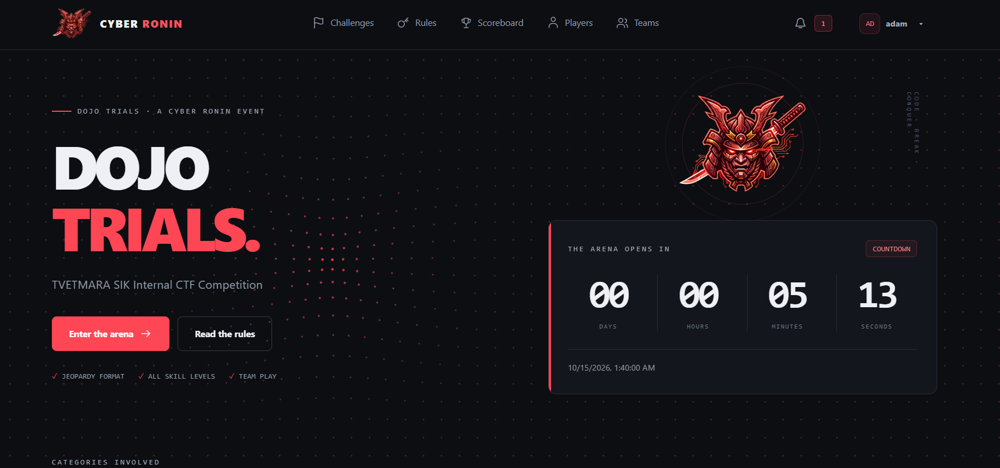
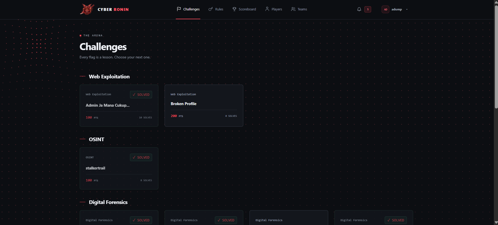
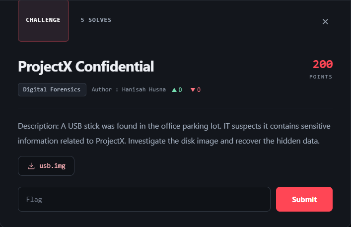
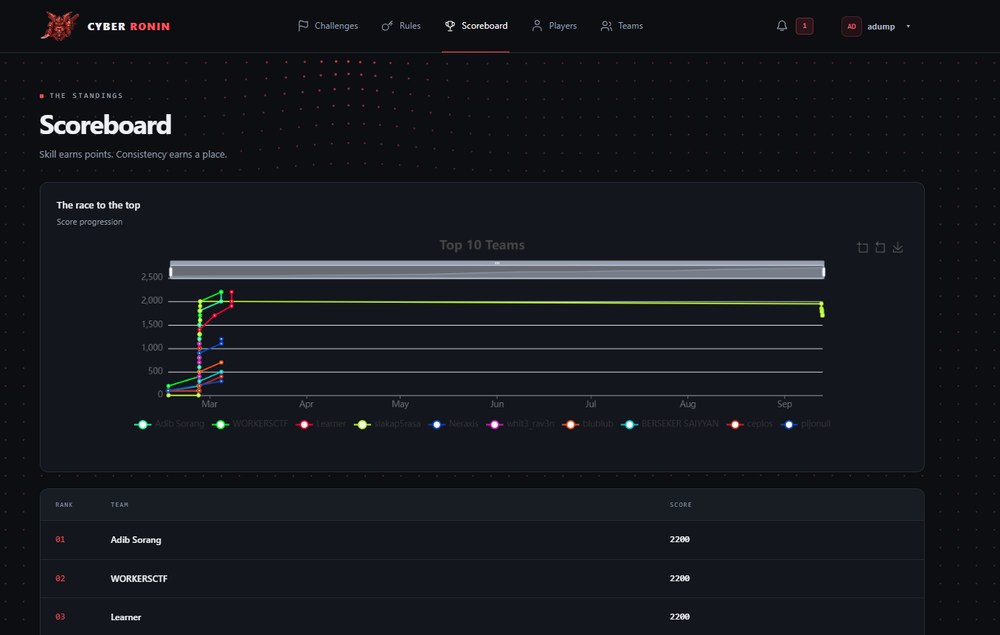
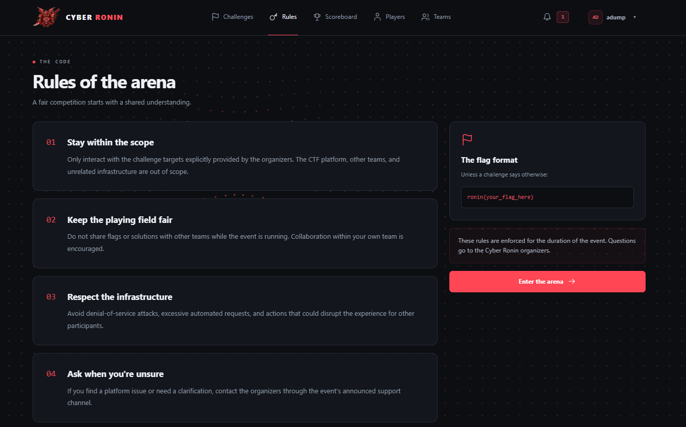
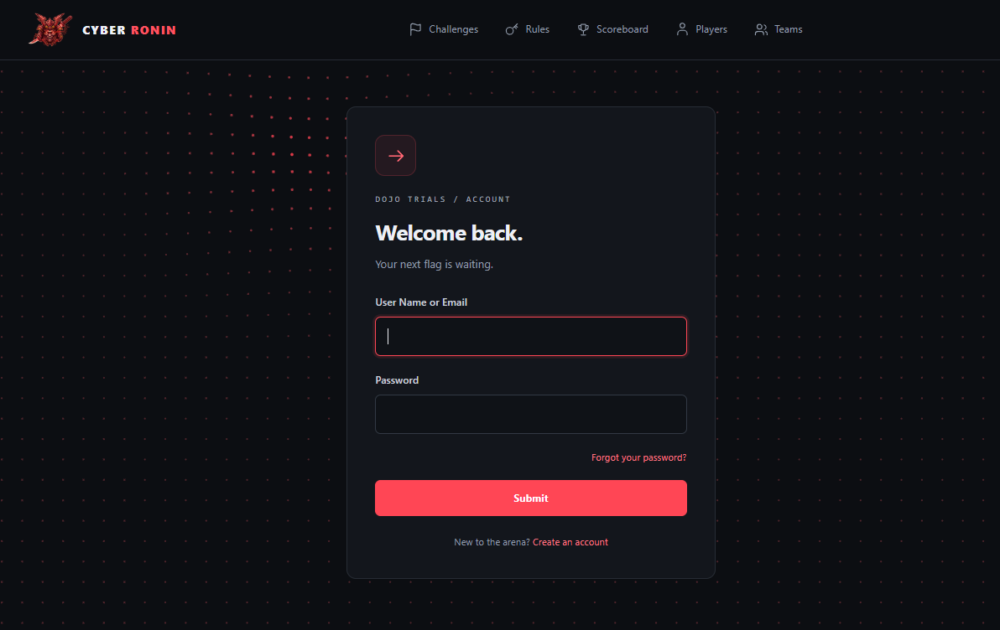
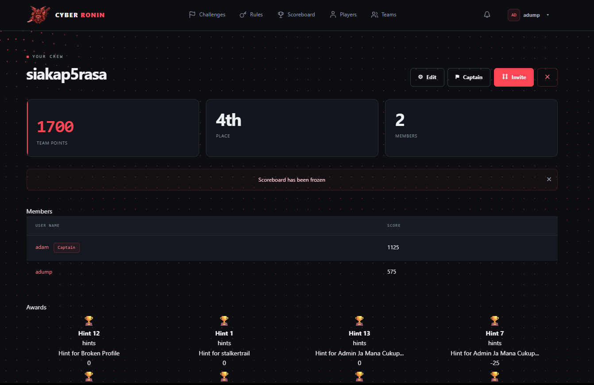

# Dojo Trials — CTFd Theme (cyber-ronin)

A custom [CTFd](https://ctfd.io) theme built for **Dojo Trials**, the TVETMARA SIK Internal CTF Competition by **Cyber Ronin**.
Dark ink + ronin-red design, a cursor-reactive dot grid background, and full compatibility with **CTFd 3.8.x** — every core endpoint, Alpine component, and plugin API works exactly as stock.

---

## Screenshots

> **TODO:** Replace the placeholders below with your own screenshots. Drop the images into `screenshots/` and keep the filenames as-is (or update the paths).

| Page | Preview |
| --- | --- |
| Landing page (hero + countdown) |  |
| Challenges board |  |
| Challenge modal |  |
| Scoreboard |  |
| Rules page |  |
| Login / Register |  |
| Team page |  |

---

## Features

- **Landing page** — hero with live event countdown (reads your event's configured start/end times), category cards, first-move steps
- **Cursor-reactive background** — a canvas dot grid that gets "sucked" toward your cursor (respects `prefers-reduced-motion`)
- **Challenges board + modal** — redesigned challenge cards, tabbed modal (Challenge / Submissions / Solves), styled hint accordions, mono flag input
- **Every page themed** — scoreboard, users, teams, profiles, settings, notifications, auth pages, error pages
- **Rules page** — bundled template + CTFd Page route (`/rules`)
- **Zero build step** — plain Jinja templates + prebuilt assets; no Node/npm required
- **CTFd-native JS** — reuses CTFd's compiled bundles, so all API endpoints (`/api/v1/...`), plugins, and Alpine components work unchanged

## Requirements

- CTFd **3.8.x** (tested on 3.8.7)
- A running CTFd instance (Docker or bare metal)

## Installation

### Option A — Docker (recommended)

Copy the `cyber-ronin` folder into your CTFd source tree so it lands inside the container:

```bash
# From your CTFd docker-compose project root
cp -r cyber-ronin CTFd/themes/

docker compose restart
```

> If your compose file bind-mounts CTFd (e.g. `./CTFd:/opt/CTFd:ro`), copy into the **host** path instead — it appears inside the container automatically.

### Option B — Bare metal

```bash
cp -r cyber-ronin /path/to/CTFd/CTFd/themes/
# then restart your WSGI server / application
```

## Activation

1. Log in as **admin**.
2. Go to **Admin Panel → Config → Theme**.
3. Select **cyber-ronin** and save.
4. If pages still show the old theme, flush your cache (Redis: `FLUSHALL`) and restart the app.

Or set it directly in the database:

```sql
UPDATE config SET value = 'cyber-ronin' WHERE `key` = 'ctf_theme';
```

## Post-install setup

1. **Logo** — served from `cyber-ronin/static/assets/logo.png` in the navbar (44px) and hero (190px). Replace that file to swap logos.
2. **Rules page** — in **Admin → Pages**, create a page with route `rules` (title "Rules"). The theme's rules template takes over rendering. Mark it *hidden* if you don't want a duplicate nav entry.
3. **Event branding** — the theme reads CTFd config (`ctf_name`, `ctf_description`, event start/end times) for the hero title, description, and countdown.
4. **Categories** — challenges group by their CTFd category. Suggested set: Web Exploitation, Cryptography, Digital Forensics, OSINT, Wildcard.
5. **Flag format** — `ronin{...}` (edit the rules template if you change it).

## Customization

| What | Where |
| --- | --- |
| Colors, fonts, components | `cyber-ronin/static/assets/ronin.css` |
| Background effect (pull strength, radius, dot size) | `cyber-ronin/templates/base.html` (canvas script near end of `<body>`) |
| Landing page copy | `cyber-ronin/templates/components/landing.html` |
| Navbar links / brand | `cyber-ronin/templates/components/navbar.html` |
| Rules content | `cyber-ronin/templates/rules.html` |

## Deploy script

An example deploy script (tar → copy → restart over SSH) is included at `scripts/deploy.py.example`. Edit the host/user/path constants at the top.

## Credits

- Theme design & build — **Cyber Ronin**
- Made for **Dojo Trials** — TVETMARA SIK Internal CTF Competition
- Built on [CTFd](https://ctfd.io)
